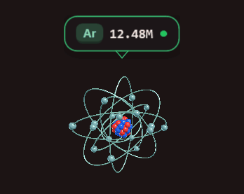
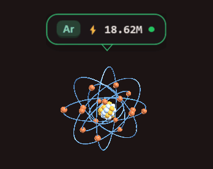
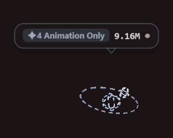
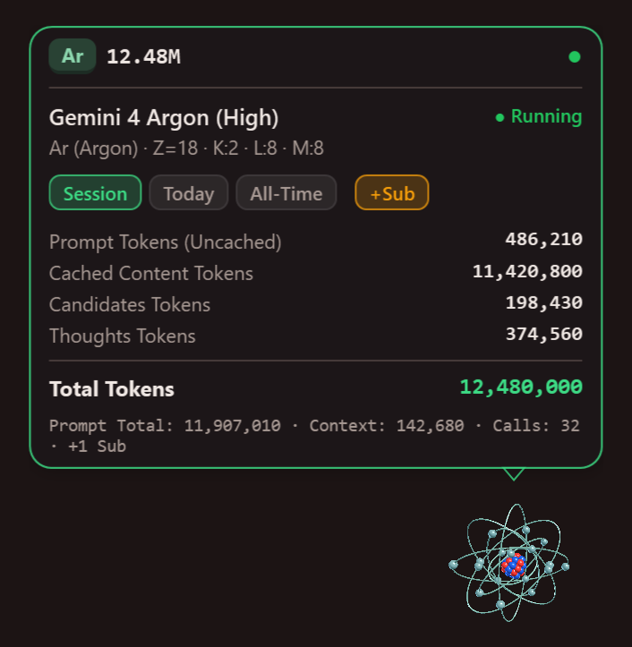
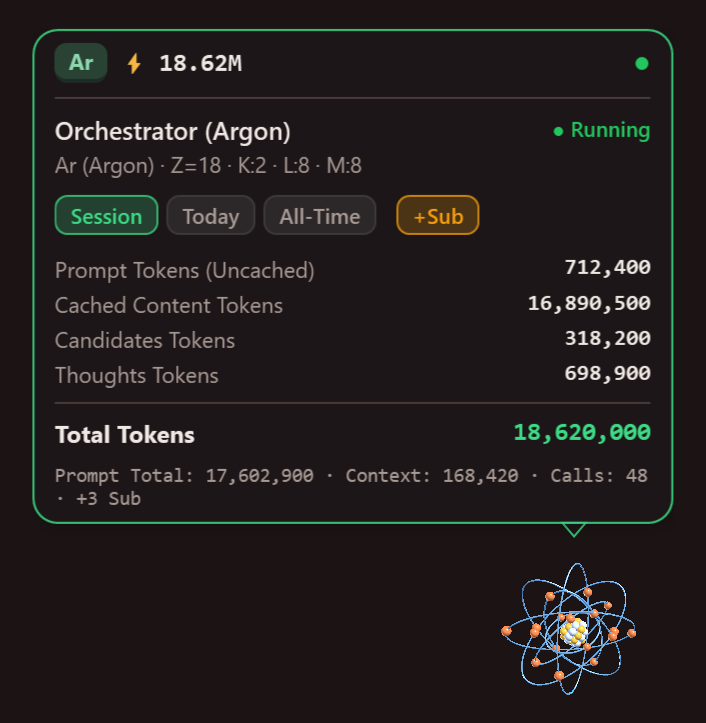
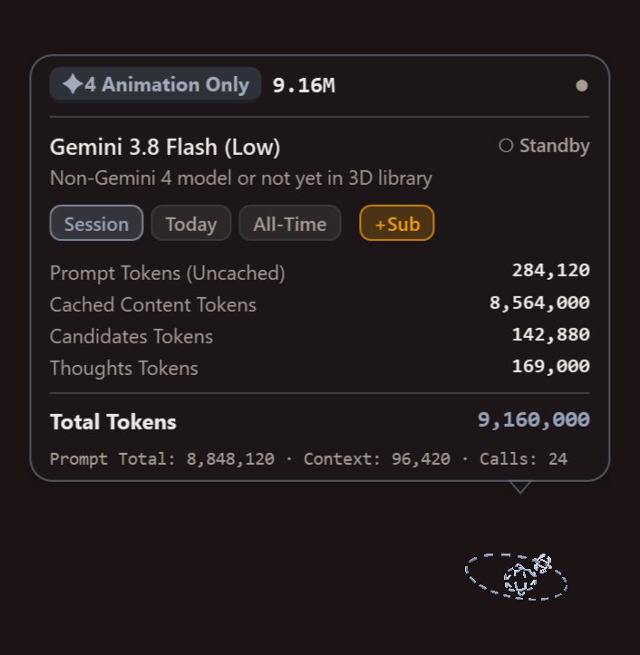
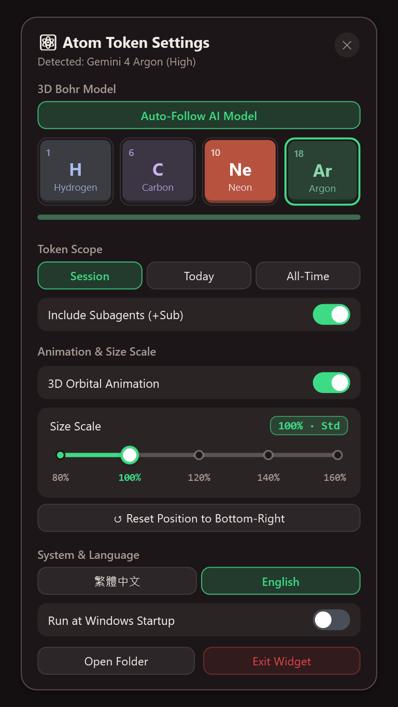
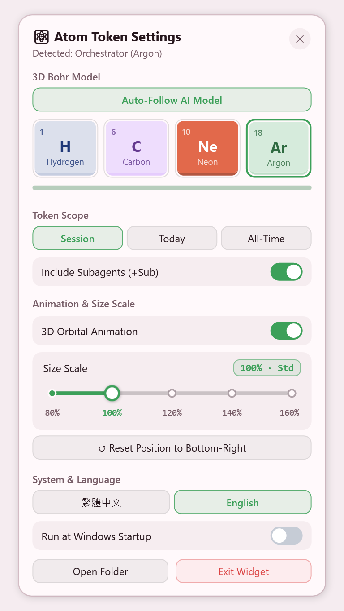

[繁體中文](./README.tw.md) | **English**

# Antigravity 3D Bohr Atom Token Widget

  

A floating 3D Token Counter widget built for **Antigravity Desktop (Antigravity 2.0 on Windows)**. Visualizes the active **Gemini 4 series model** with a 3D Bohr-Rutherford atom model styled to match the **Google AI Studio Periodic Table** palette.

---

- **3D Bohr Atom Model (Supported Gemini 4 Model Library Only, incl. Orchestrator)**
  - **Auto-Detect Model & Thinking Level**: Automatically identifies active model names and thinking tiers, applying 3D animations immediately for cataloged models while switching uncataloged or non-Gemini 4 models to the neutral gray 3D model without losing the real model name or Token counter. Automatically detects and switches models when switching conversations; selecting a manual preview element preserves the real model name and appends `[Element Preview]`.
  - **Element Colors**: Features Light/Dark dual color palettes and 3D bottom edge lips that update automatically when switching elements manually or automatically.
  - **Auto-Adaptive Orchestrator Finish**: Automatically detects Orchestrator mode and Light/Dark themes, rendering protons, neutrons, and electrons in metallic **Gold / Silver / Copper** finishes with subtle **blue electric current effects** along the electron orbits.
- **Token Breakdown Statistics**
  - Reads local Antigravity conversation history in read-only mode and displays official Gemini `UsageMetadata` labels: `Prompt Tokens (Uncached)`, `Cached Content Tokens`, `Candidates Tokens`, `Thoughts Tokens`, and `Total Tokens`.
- **Free Dragging**
  - Freely drag the 3D model to any preferred position within the application window.
- **Minimal Bubble + Hover Expand + Dedicated Settings Window**
  - **Collapsed by Default**: Displays a compact bubble above the 3D atom (element tile + `Total Tokens`); moving the cursor into the bubble smoothly expands the full breakdown and one-click scope toggles (**Session / Today / All-Time** + **+Subagents toggle**).
  - **In-App Right-Click Settings Window**: Right-click the 3D model or bubble to open Settings, with model selector strip, animated/static toggle, real-time size slider (5 presets: `80% / 100% / 120% / 140% / 160%`), and position reset.

---

## 📸 Live Previews

### 3D Model Motion

| Argon (`Ar`, Z=18) | Orchestrator Argon (Metallic + Electric Orbit) | Non-Gemini 4 Model (Hollow Dashed 3D) |
| :---: | :---: | :---: |
|  |  |  |

### Hover-Expanded Token Details

| Argon (`Ar`) Token Details | Orchestrator Argon Token Details | Non-Gemini 4 Token Details |
| :---: | :---: | :---: |
|  |  |  |

### In-App Right-Click Settings Menu

| Dark Mode (Argon) | Light Mode (Orchestrator Argon) |
| :---: | :---: |
|  |  |

---

## 💻 System Requirements

- **Windows 10 / Windows 11**
- **[Antigravity App](https://antigravity.google/download?os=windows)**

---

## 🚀 Quick Start

1. Download the latest ZIP from **[Releases](https://github.com/Evan-1230/)** (or click **`Code` → `Download ZIP`**) and extract it to any folder.
2. Double-click **`Install_widget.bat`** in the root folder.
3. Wait a few seconds for local compilation and configuration to finish; the 3D widget will launch automatically.
4. If Antigravity is already open and the model hasn't updated yet, press **`Ctrl + R`** inside the Antigravity window to reload the UI or **restart the application**.
5. Double-clicking **`Install_widget.bat`** compiles and launches the widget locally (installed to `%LOCALAPPDATA%\AntigravityAtomTokenWidget`).
6. Double-clicking **`Uninstall_widget.bat`** closes the widget, removes the Windows startup entry, and completely removes the installation directory.

---

## 🖱️ System Tray Menu

Once launched, an icon appears in the bottom-right Windows taskbar under `∧`. **Double-click the icon** to quickly show/hide the floating atom widget, or **right-click** to configure:

- **3D Bohr Atom Model**: Auto-Follow AI Model (Auto) / Gemini 4 series models (`Supported models:` [Releases]())
- **Token Scope**: Current Conversation (Session) / Today / All-Time / Include Subagents (`+Subagents`)
- **Widget Size**: `80%` / `Standard (100%)` / `120%` / `140%` / `160%` (if the in-app slider is set between these five presets, no checkmark is shown, while any preset can still be selected directly from the menu)
- **Enable 3D Animation**: Toggle 3D rotational animation on/off (displays statically when disabled)
- **Hide Floating Widget (Double-Click)**: Quickly show or hide the floating atom widget
- **Reset to Bottom-Right**: Reset the floating position back to the default bottom-right corner
- **Language / 語言**: 繁體中文 / English
- **Run at Windows Startup** (disabled by default; check to enable)
- **Open Widget Folder** / **Exit**

---

## 🧹 One-Click Restore

If you want to uninstall the widget and restore your previous setup, double-click **`Uninstall_widget.bat`** (or `%LOCALAPPDATA%\AntigravityAtomTokenWidget\Uninstall_widget.bat`).

**Auto-Restore**:
- Automatically removes any startup entry (if enabled) and all installed widget files.
- After restoring, press **`Ctrl + R`** inside the Antigravity window afterward if needed to refresh cleanly.

---

## 🍎 macOS / 🐧 Linux Users

Open this project using Antigravity's `Browser` feature and just ask **Gemini** to build it for you 🙃

---

## 🔒 License & Disclaimer

- **License**: All source code and scripts in this project are licensed under the [MIT License](./LICENSE).
- **Risk Notice**: This pack never modifies any files in the official installation directory and does not affect `Antigravity` automatic updates.
