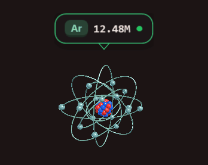
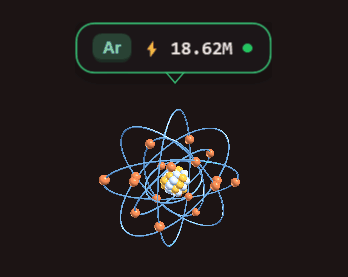
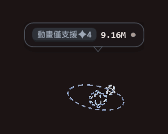
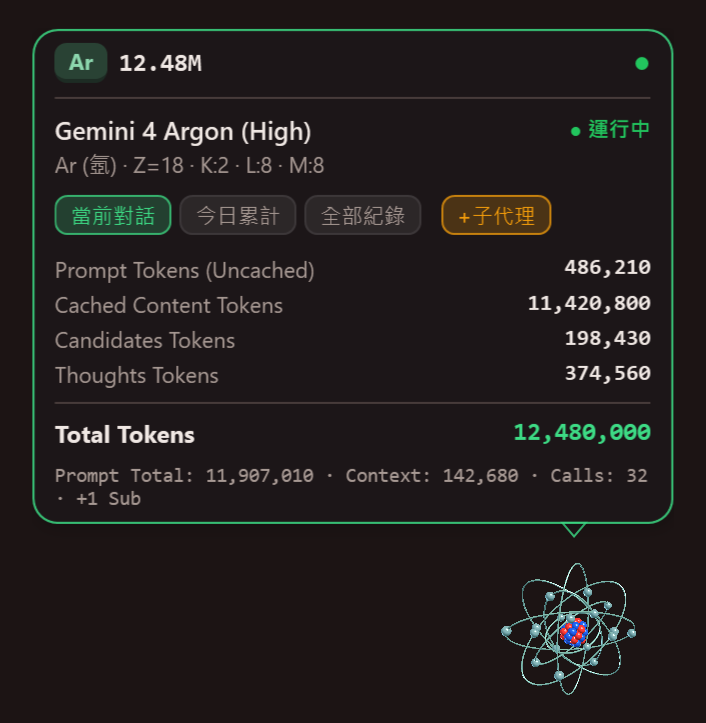
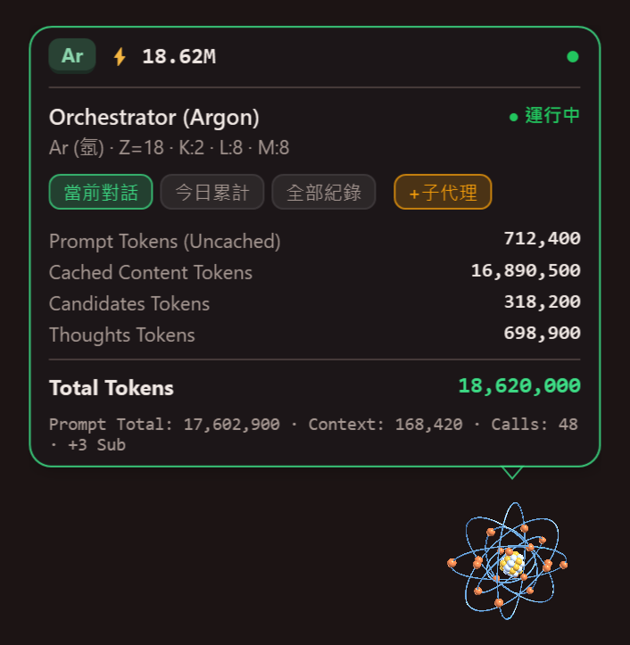
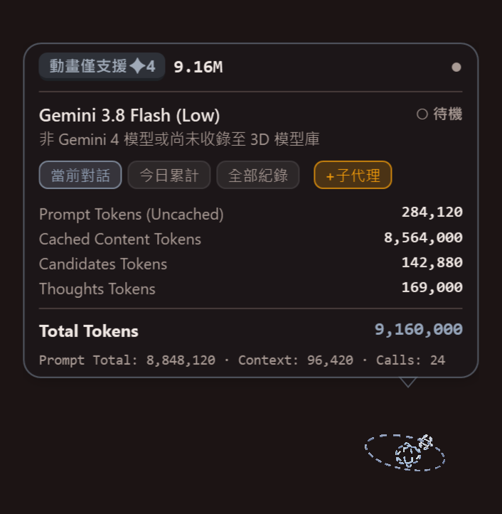
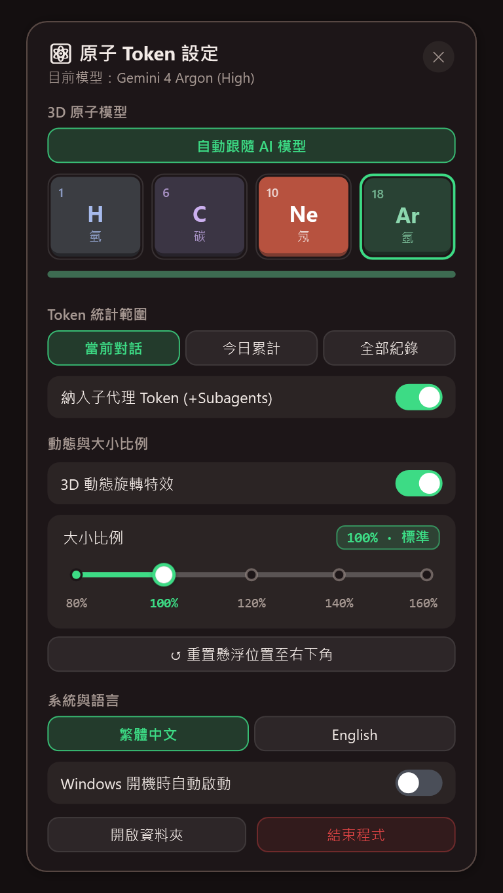
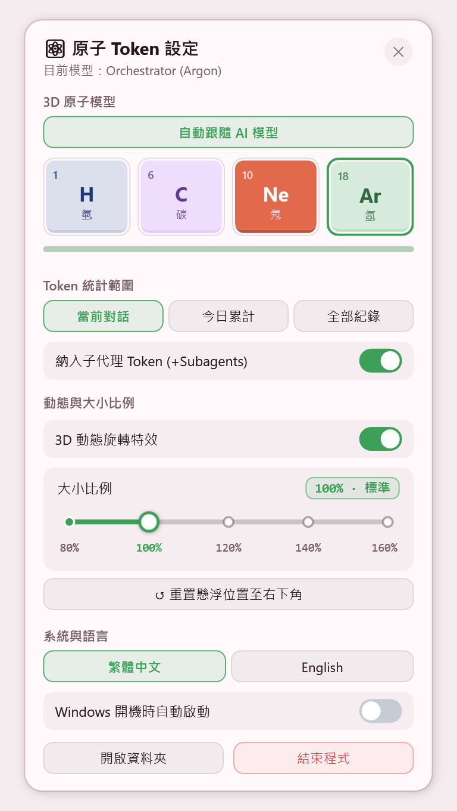

**繁體中文** | [English](./README.md)

# Antigravity 3D 波耳原子模型 Token 計算器

  

為 **Antigravity 桌面版（Antigravity 2.0 on Windows）** 打造的 3D 懸浮 Token 統計小工具。以立體波耳－拉塞福原子模型（3D Bohr-Rutherford Atom）視覺化呈現目前使用中的 **Gemini 4 系列模型**，並對應 **Google AI Studio 元素週期表選單**配色。

---

- **立體 3D 波耳原子模型（僅支援已收錄之 Gemini 4 模型庫，含 Orchestrator）**
  - **自動檢測模型與思考等級**：自動辨識模型名稱與各種思考等級，已收錄模型即時套用 3D 動畫，未收錄或非 Gemini 4 模型則切換經典灰色 3D 模型，維持顯示真實模型名稱與Token，切換對話時亦會自動檢測並切換切換;選擇手動預覽元素時會保留真實模型名稱並加註 `[Element Preview]`。
  - **元素配色**：具備深色／淺色主題雙配色與立體底邊條設計，手動/自動切換元素時變更為相應配色。
  - **Orchestrator 模式自動適應質感**：自動偵測 Orchestrator 模式與淺／深色主題，質子、中子與電子分別呈現**金屬金 / 銀 / 銅**質感，並於電子軌道附帶柔和的**藍色電流特效**。
- **Token 細項統計**
  - 直接以唯讀模式讀取本機 Antigravity 對話紀錄，依官方 Gemini `UsageMetadata` 正式名稱顯示：`Prompt Tokens (Uncached)`、`Cached Content Tokens`、`Candidates Tokens`、`Thoughts Tokens` 與 `Total Tokens`。
- **自由拖動** 
  - 可將 3D 模型自由拖動至應用程式內心儀的位置。
- **極簡氣泡 ＋ 游標展開 ＋ 專屬設定視窗**
  - **預設收合**：3D 原子上方僅顯示小巧氣泡（元素方塊 ＋ 總消耗 `Total Tokens`）；游標移入氣泡即平滑展開完整明細與單鍵範圍切換（**當前對話 / 今日累計 / 全部紀錄** ＋ **+子代理開關**）。
  - **App 內右鍵設定視窗**：在 3D 模型或氣泡按右鍵開啟設定視窗，支援模型選擇列、動態／靜態切換、實時尺寸滑動條（`80% / 100% / 120% / 140% / 160%` 五檔）與位置重置。

---

## 📸 實際畫面預覽

### 3D 模型運作動畫

| Argon（`Ar`, Z=18） | Orchestrator Argon（金屬質感＋電流軌道） | 非 Gemini 4 模型（空心虛線 3D） |
| :---: | :---: | :---: |
|  |  |  |

### 游標展開詳細 Token 統計

| Argon（`Ar`）詳細 Token | Orchestrator Argon 詳細 Token | 非 Gemini 4 模型詳細 Token |
| :---: | :---: | :---: |
|  |  |  |

### App 內右鍵設定選單

| 深色模式（Argon） | 淺色模式（Orchestrator Argon） |
| :---: | :---: |
|  |  |
<table><tr><th width="50%">深色模式（Argon）</th><th width="50%">淺色模式（Orchestrator Argon）</th></tr><tr><td></td><td></td></tr></table>

---

## 💻 系統需求

- **Windows 10 / Windows 11**
- **[Antigravity App](https://antigravity.google/download?os=windows)**

---

## 🚀 快速開始

1. 前往 **[Releases](https://github.com/Evan-1230/Antigravity-App-Atom-Token-Widget/releases)** 下載最新 ZIP 檔（或點擊右上角 **`Code` → `Download ZIP`**）並解壓縮至任意資料夾。
2. 雙擊執行根目錄的 **`Install_widget.bat`**。
3. 等待數秒完成本機編譯與設定套用後， 3D 模型將自動啟動。
4. 若 Antigravity 目前已開啟且模型尚未更新，請在 Antigravity 視窗內按 **`Ctrl + R`** 重新載入介面或**重新啟動應用程式**。

---

## 🖱️ 右下角工作列選單功能

啟動後會在 Windows 右下角工作列 `∧` 顯示圖示，**雙擊圖示**可快速顯示／隱藏懸浮原子小工具，**按右鍵**可設定：

- **3D 原子模型顯示**：自動跟隨 AI 模型 (Auto) ／ Gemini 4 系列模型（`支援模型詳見`[Releases](https://github.com/Evan-1230/Antigravity-App-Atom-Token-Widget/releases)）
- **Token 統計範圍**：當前對話 (Session) ／ 今日累計 (Today) ／ 全部紀錄 (All-Time) ／ 納入子代理 (`+Subagents`)
- **模型尺寸比例**：`80%` ／ `標準 (100%)` ／ `120%` ／ `140%` ／ `160%`（若於 App 內設定滑動條拉至非此五檔的數值則不顯示勾選，仍可直接從選單切回任一檔位）
- **開啟動態效果**：開／關 3D 動態旋轉特效（關閉時靜態顯示）
- **隱藏懸浮小工具（雙擊圖示）**：快速顯示或隱藏懸浮原子小工具
- **重置位置至右下角**：將懸浮位置重設回預設右下角
- **語言切換（語言 / Language）**：繁體中文 ／ English
- **開機時自動啟動**（預設關閉，可自行勾選）
- **開啟程式資料夾** ／ **結束**

---

## 🧹 一鍵完整還原

若想移除主題並恢復安裝前的樣子，直接雙擊執行 **`Uninstall_widget.bat`**（或 `%LOCALAPPDATA%\AntigravityAtomTokenWidget\Uninstall_widget.bat`）。

**自動復原**：
- 自動移除開機自動啟動項（若有啟用）與安裝檔案。
- 還原後在 Antigravity 視窗內按 **`Ctrl + R`** 即可恢復。

---

## 🍎 macOS / 🐧 Linux 使用者

在 Antigravity 使用 `Browser` 功能開啟本專案，然後直接請 **Gemini** 幫你做吧🙃

---

## 🔒 授權與聲明
- **開源授權**：本專案所有程式碼與腳本依 [MIT License](./LICENSE) 授權。
- **風險聲明**：本套件不更動官方安裝目錄中的任何檔案，不影響 `Antigravity` 自動更新。
